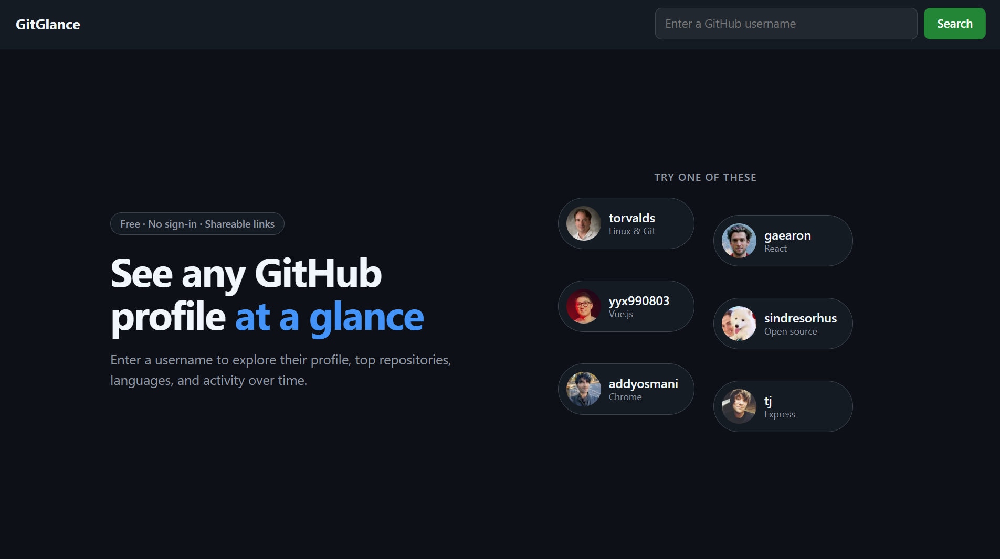
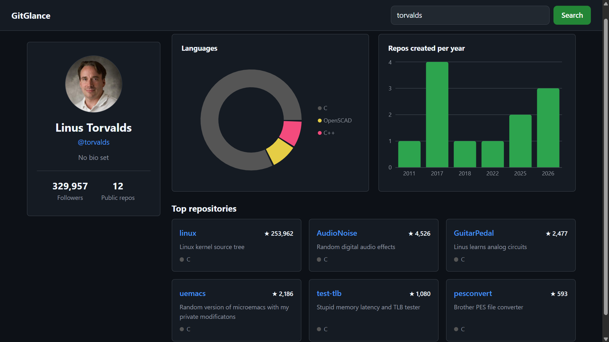

<p align="center">
  
</p>

<h1 align="center">GitGlance</h1>

<p align="center">
  See any GitHub profile at a glance: languages, activity over time, and top repositories.
  <br>
  <strong><a href="https://git-glance-three.vercel.app/">Live demo</a></strong>
</p>





## Features

- **Search any GitHub user** and see their avatar, bio, followers, and public repo count
- **Languages chart**: a donut chart of the languages across their repositories, in GitHub's own language colors
- **Activity chart**: how many repositories they created each year
- **Top repositories**: their six most-starred repos, with description, language, and stars
- **Shareable links**: every profile has its own URL (`/u/torvalds`) that survives a refresh, so you can send it to someone
- **Rate-limit aware**: shows how many GitHub API requests you have left, and when the limit resets
- **Caching**: profiles you looked at in the last 5 minutes load instantly without using any API requests
- **Clear loading, error, and empty states**: skeleton placeholders, "user not found", rate limit reached, network errors, and users with no repositories
- **Light and dark mode** that follows your system setting, and a layout that works on phones

## Tech stack

- [React](https://react.dev) + [Vite](https://vite.dev), plain JavaScript
- [React Router](https://reactrouter.com) for shareable profile URLs
- [Recharts](https://recharts.github.io) for the charts
- [GitHub REST API](https://docs.github.com/en/rest) (no authentication, no backend)
- Plain CSS, using colors from GitHub's design system
- Deployed on [Vercel](https://vercel.com)

## How it works

1. Searching navigates to `/u/<username>`. **The URL is the source of truth** for which profile is shown, so shared links, refreshes, and the back button all go through the same path.
2. A custom hook, `useGithubUser(username)`, fetches the profile and the repositories **in parallel** with `Promise.all`, inside a `useEffect` that re-runs whenever the username changes.
3. The effect's **cleanup function** marks old requests as stale, so a slow response for a previous user can never overwrite the current one (a race condition).
4. Results are cached in `sessionStorage` for 5 minutes. Rate-limit numbers come from GitHub's `x-ratelimit-*` response headers.
5. Pure helper functions (`reduce`) turn the raw repo list into chart data, which is **derived during render** instead of stored in state.

## What I learned

I built this to relearn React properly, writing all of the logic myself and making sure I understood every line. Some of the things that took real effort:

- Controlled inputs, form submit events, and why a form reloads the page when `preventDefault` never runs
- `fetch` only rejects on network failures, so HTTP errors like 404 need a `response.ok` check
- Running requests in parallel with `Promise.all`, and handling each response's errors separately
- Sorting without mutating state (`toSorted`), and deriving values instead of duplicating state
- Pure functions and `reduce` for turning API data into chart data
- Custom hooks, lifting state up, and how data flows down as props
- `useEffect` cleanup and closures, and how an `ignore` flag prevents race conditions
- Reading response headers, caching with Web Storage, and when to stop trusting cached data
- Using `key` to reset a component's state, and React Router route params
- Deploying a single-page app, and why the host needs a rewrite to `index.html`

## Run it locally

You need [Node.js](https://nodejs.org) installed.

```bash
git clone https://github.com/dinogavrovski/Github-Profile-Visualizer.git
cd Github-Profile-Visualizer
npm install
npm run dev
```

Then open the URL that Vite prints (usually http://localhost:5173).

## Project structure

```
src/
├── App.jsx                  # routes the page: landing or profile dashboard
├── hooks/useGithubUser.js   # fetching, caching, race-condition handling
├── utils/repoStats.js       # pure functions that build the chart data
└── components/
    ├── Search.jsx           # the search form
    ├── Landing.jsx          # landing page with example profiles
    ├── Profile.jsx          # profile card
    ├── RepoList.jsx         # top repositories
    ├── ProfileSkeleton.jsx  # loading placeholder
    └── charts/              # language and activity charts
```

## Limitations

- GitHub allows **60 requests per hour** without signing in, and each new profile uses 2
- Only the first **100 repositories** of a user are included in the charts

## Ideas for later

- Compare two developers side by side
- A contribution heatmap, using GitHub's GraphQL API through a small serverless function so the token stays off the frontend
- Rewrite the data fetching with TanStack Query and compare it to the hand-written version
- TypeScript, and tests with Vitest and React Testing Library
